# Architecture

```mermaid
flowchart LR
    Sources[Configured public sources or mock discovery] --> Research[Captured text and cited facts]
    Research --> Contacts[Company and named contact route checks]
    Contacts --> Draft[Typed paragraphs and writing checks]
    Draft --> Human[Exact message human review]
    Human --> Release[Trusted signed expiring release]
    Release --> Gate[History suppression identity window caps]
    Gate --> Reserve[SQLite atomic reservation]
    Reserve --> Mail[Gmail or mock transport]
    Mail --> Reply[Inbound classification]
    Reply --> Stop[Cancel follow-ups and suppress opt-outs]
    Reply --> Response[New exact response review]
    Response --> Interest[Verified interest gate]
    Interest --> Calendar[Read associated accepted Calendar event]
    Calendar --> Outcomes[Audit outcomes and advisory learning]
    Outcomes --> Projection[Notion system-owned projection]
```

`src/engine.mjs` coordinates the boundary. `evidence.mjs`, `writing.mjs`, `security.mjs` and `time.mjs` are policy components. `store.mjs` owns durable SQLite persistence, transactions and a database tenant guard. `providers/` owns isolated integration transport; every external adapter accepts a test transport. `reporting.mjs` projects system-owned state and summarizes observations. The demo uses only mock providers and random ephemeral keys.

Canonical entities are prospect, captured source, typed claim, contact/route, offer, exact message, approval, release, consent, suppression, attempt, inbound event, sequence/work, calendar outcome, integration projection, audit and cost. Source quotes and hypotheses remain separate. One prospect can have an initial, up to three follow-ups and separately approved responses associated with inbound events.

SQLite `BEGIN IMMEDIATE` serializes reservations. Attempts have unique message IDs, unique parent/touch keys and unique response/inbound keys. All reserved/uncertain attempts count against daily caps. Admission occurs before provider transport, with a final current-state recheck; uncertain completion cannot be retried automatically. Network calls never hold a long-running database transaction.

Source freshness changes revoke unsent approval. A sent initial's immutable digest and configuration hash govern its follow-up permission; fresh sources still govern each new follow-up release. Inbound is idempotent by provider event ID. Every reply stops follow-ups; newer inbound invalidates pending responses. Notion stores a projection under a stable engine ID and can never approve a message. Projection writes are off by default.

The main application serves an authenticated operator console and durable worker on loopback. The console supports individual exact-copy review and source/permission inspection; it has no send or activation endpoint. The separate reference dashboard remains a static fictional-demo snapshot. Reporting's provider acceptance, Calendar outcomes and simulated results are distinct from verified inbox delivery and commercial value.

This local architecture does not depend on the original hosted product, any existing database project, live Notion page or task. The local verifier collects selected real owned-mailbox artifacts and authenticated integration checks. A hosted adapter would additionally need a durable shared store with tenant access controls, server-owned roles/secrets and atomic reservations; do not assume SQLite locking works across machines.

The durable scheduler uses time-slot job IDs, transactional per-worker leases, heartbeats and bounded read retries. Owner notifications use a separate outbox but share mailbox caps/pacing with prospects. `verifier.mjs` separates actual provider observations from simulated fixtures. `readiness.mjs` separates business verification from activation and message approval. Migration checksums and consistent backup/reconciliation make restart and recovery explicit.

The local deployment favors simple zero-dependency operation over distributed scaling: one business per protected database, loopback UI, existing-machine service and explicitly reviewed authoring. Revisit storage, user roles, public network authentication, retention and remote-worker coordination before expanding beyond that boundary.
